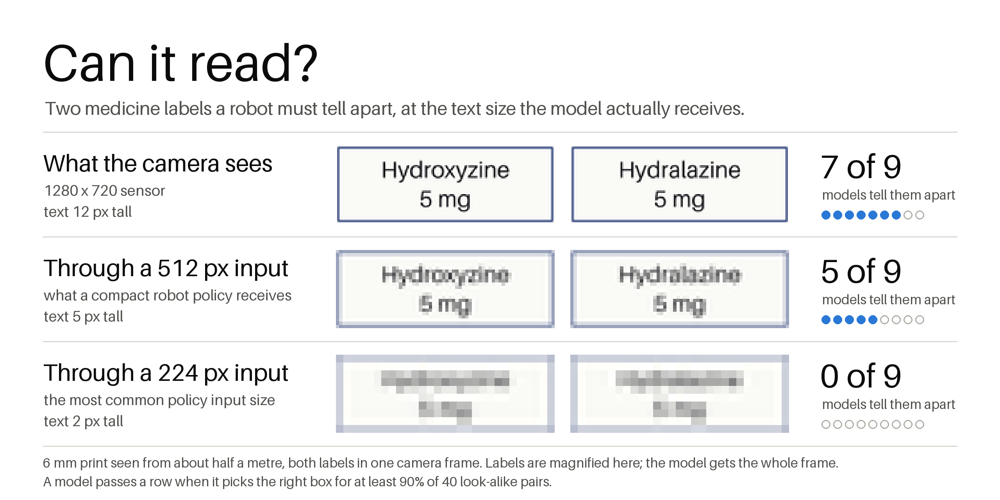

<p align="center">
  <picture>
    <source media="(prefers-color-scheme: dark)" srcset="assets/hero-dark.png">
    
  </picture>
</p>

# Read before you act

**Can your model read the label before it acts on it?**

Small vision-language models are going onto robots and phones to read things that matter: a drug name on a carton, a dose, a field on a form. This project measures when they can actually read, when they only appear to, and what a system needs in order to know the difference. It starts with a test you can run on any model in a few minutes.

[](LICENSE)

[](CONTRIBUTING.md)

## Try it

```bash
pip install -r requirements.txt
```

```bash
python canitread.py --model HuggingFaceTB/SmolVLM2-500M-Video-Instruct --quick
```

It runs in a few minutes on one GPU and prints:

```text
HuggingFaceTB/SmolVLM2-500M-Video-Instruct

  LABEL CROPS: each label on its own
  text    told apart                   95% interval
  24 px  ██████████████████████    92%   [65–99]
  16 px  ████████████████████████ 100%   [76–100]
  12 px  ██████████████████████    92%   [65–99]
  10 px  ████████████████████████ 100%   [76–100]
   8 px  ██████████████████████    92%   [65–99]
   6 px  ████████████████████████ 100%   [76–100]
   5 px  ██████████████████████    92%   [65–99]
   4 px  ████████████████          67%   [39–86]
   3 px  ████████████              50%   [25–75]
   2 px  ██████                    25%   [9–53]

  acuity: 5 px. That is the smallest text at which it tells look-alike labels apart.
  Handed the label crop from a 1280x720 camera, it could read 6 mm print from about 113 cm at best.

  WHOLE FRAME: both labels in one camera frame, as a robot policy receives it (chance is 50%)
  6 mm print at 23 cm, 24 px tall on the sensor
    camera resolution  ██████████████████████    92%   [65–99]
    512 px input       ████████████████████████ 100%   [76–100]
    224 px input       ██████████████████        75%   [47–91]
  6 mm print at 47 cm, 12 px tall on the sensor
    camera resolution  ████████████████████████ 100%   [76–100]
    512 px input       ████████████████████████ 100%   [76–100]
    224 px input       ██████████████            58%   [32–81]
```

The test shows the model pairs of look-alike labels, such as Hydroxyzine and Hydralazine or 5 mg and 50 mg, in two ways:

- **Label crops.** The model transcribes each label on its own at shrinking text sizes. Its *acuity* is the smallest text, measured as the height of a capital letter in pixels, at which it still tells 90% of pairs apart.
- **Whole frame.** The model sees both labels in one 1280×720 camera frame and says which box is the target. The frame is given at camera resolution and resized to 512 and 224 pixels, which is what robot policies do before the model sees anything.

Nothing else is needed: no simulator, no data set, no font files. The labels are drawn with Pillow's built-in font, so the test is identical on every machine. Any image-text-to-text model on the Hugging Face Hub that ships a chat template should run. Drop `--quick` for the full 40-pair chart.

## Leaderboard

Full chart, 40 look-alike pairs per row. *Acuity* and the pixel columns come from label crops. The *Frame* columns are the whole-frame test with 6 mm print at 47 cm (12 pixels tall on the sensor), where 50% is a coin flip.

| Model | Precision | Acuity on crops | 6 px | 4 px | 3 px | 2 px | Frame: camera | Frame: 512 px | Frame: 224 px |
|---|---|---|---|---|---|---|---|---|---|
| `zai-org/GLM-OCR` | bfloat16 | **3 px** | 100% | 92% | 92% | 70% | – | – | – |
| `Qwen/Qwen3.5-2B` | bfloat16 | **3 px** | 100% | 98% | 90% | 62% | 100% | 100% | 50% |
| `Qwen/Qwen2.5-VL-7B-Instruct` | bfloat16 | **4 px** | 100% | 98% | 80% | 65% | 100% | 100% | 65% |
| `Qwen/Qwen3.5-2B` | 4bit | **4 px** | 100% | 95% | 85% | 55% | 100% | 95% | 50% |
| `Qwen/Qwen2.5-VL-3B-Instruct` | bfloat16 | **4 px** | 100% | 100% | 72% | 60% | 100% | 98% | 50% |
| `zai-org/GLM-OCR` | 4bit | **4 px** | 92% | 90% | 82% | 68% | – | – | – |
| `PaddlePaddle/PaddleOCR-VL-1.6` | bfloat16 | **4 px** | 98% | 92% | 68% | 40% | – | – | – |
| `OpenGVLab/InternVL3-2B-hf` | bfloat16 | **5 px** | 90% | 85% | 52% | 38% | 98% | 95% | 70% |
| `llava-hf/llava-onevision-qwen2-0.5b-ov-hf` | bfloat16 | **5 px** | 95% | 68% | 48% | 38% | 92% | 62% | 50% |
| `HuggingFaceTB/SmolVLM2-256M-Video-Instruct` | bfloat16 | **5 px** | 100% | 55% | 38% | 52% | 50% | 50% | 50% |
| `HuggingFaceTB/SmolVLM2-500M-Video-Instruct` | bfloat16 | **6 px** | 98% | 57% | 40% | 40% | 100% | 88% | 55% |
| SmolVLM2-500M with tiling off (`smolvlm2-500m-64tok`) | bfloat16 | **6 px** | 92% | 57% | 28% | 25% | 50% | 50% | 50% |

- Run on one NVIDIA L4 on 19 November 2026 with chart 0.1 and `transformers` 5.20. The result files are in [results/canitread](results/canitread).
- A dash means the model only transcribes, so it cannot take the whole-frame test.
- "Tiling off" is the single-image, 64-token setting that SmolVLA uses for this backbone.
- `HuggingFaceTB/SmolVLM2-2.2B-Instruct` crashed inside `transformers` on these inputs and is not listed.

**Add your model.** Run the full chart and open a pull request with the two result files it writes. Details are in [CONTRIBUTING.md](CONTRIBUTING.md).

## What the numbers say

- **Through a 224-pixel input, nobody can read it.** With 6 mm print at 47 cm, none of the nine general setups passes. They score 50–70%, and six of them answer "left" every single time.
- **The same frame at camera resolution is easy.** Seven of nine score 92–100%. Five of nine still pass at 512 pixels.
- **Getting closer fixes it.** Halve the distance to 23 cm and the 224-pixel input works again: those seven setups score 80–100%.
- **Two tiny setups cannot do the task at any size.** SmolVLM2-256M and SmolVLM2-500M with tiling off answer "left" whatever they are shown, although both read enlarged crops down to 5–6 pixels.
- **On enlarged crops, small readers are sharp.** GLM-OCR and Qwen3.5-2B tell look-alike drug names apart at text 3 pixels tall. A 7B model does no better than a 2B one.
- **4-bit costs about one pixel.** Qwen3.5-2B and GLM-OCR both go from 3 to 4 pixels.

## Why this matters for robots

Robot policies shrink the camera image before the model sees it. [OpenVLA](https://arxiv.org/abs/2406.09246) uses 224×224 inputs, and [SmolVLA](https://arxiv.org/abs/2506.01844) resizes frames to 512×512 and keeps 64 visual tokens per frame. Print that is 6 mm tall, seen from half a metre by a 1280×720 camera, is about 12 pixels tall on the sensor, 5 pixels after resizing to 512, and 2 pixels after resizing to 224. No amount of training recovers characters that are not in the input.

The test above is a best case: flat, front-on labels in clean print. In 540 simulated scenes with perspective, lighting and a handwriting-style font (`render_labels.py`, `eval_legibility.py`), the same question was harder. Share of scenes in which the model picked the right box, for Qwen2.5-VL-3B / Qwen3.5-2B:

| What the model sees | 1.0 m | 0.7 m | 0.5 m | 0.35 m | 0.22 m |
|---|---|---|---|---|---|
| Whole frame at 224 px | 47 / 47 | 42 / 43 | 56 / 60 | 51 / 66 | 69 / 79 |
| Whole frame at 512 px | 49 / 48 | 42 / 57 | 76 / 76 | 93 / 91 | 97 / 99 |
| Whole frame at camera resolution | 57 / 59 | 81 / 84 | 99 / 99 | 100 / 99 | 100 / 100 |

The camera image contains what the downsized input loses, and moving closer fixes what cropping cannot.

## A robot policy in closed loop

Does a trained robot policy read? We fine-tuned [SmolVLA](https://arxiv.org/abs/2506.01844) to move onto the carton named in its instruction, with two identical cartons carrying look-alike labels, and ran it for 200 episodes per setting in simulation.

| The policy is told | Right carton |
|---|---|
| The label text, camera at 0.60 m | 54.5% |
| The label text, camera at 0.25 m | 50% |
| The label text, with its vision-language backbone also trained | 47% |
| A green outline on the right carton | **100%** |
| An outline placed by a 2B reader that moves the camera closer until it is sure (2 mm print) | **96.5%**, with 2.5% wrong among the picks it made against a certified 5% |

Told the text, the policy goes left or right about equally often: it acts without reading. Told by a pointer, with the same data and training, it never misses. A small reader that looks at the full-resolution camera image, moves closer when unsure, and hands its choice to the policy closes the gap. Details, limits and the commands to reproduce it are in [closed_loop/README.md](closed_loop/README.md).

## Also in this repository

| Question | Script | What the first run found |
|---|---|---|
| Can a robot stop approaching as soon as it is sure? | `simulate_look_closer.py` | Moving closer only until the reader is confident reached a 5% error target with 23–46% fewer camera moves than always going to a fixed distance. The rule has no statistical guarantee yet. |
| Do small readers make things up? | `eval_handwriting.py` | On blank or blurred input they mostly return nothing. On barely legible handwriting (9 pixels high), 80–90% of answers were fluent, full-length and wrong. |
| What does 4-bit compression cost? | `eval_handwriting.py` | Coverage. Holding error near 10%, readers answered 8 to 19 points fewer lines. |
| How far behind is Vietnamese handwriting? | `eval_handwriting.py` | At best about half of clean scanned lines were read correctly, against 85–98% for English. |

Full tables are in [results/summary.md](results/summary.md) and [results/look_closer.md](results/look_closer.md). To rerun these, install `requirements-scenes.txt` and see the comments at the top of each script.

## Limits

- The reading test is a best case, as described above. Treat its numbers as an upper bound on what a model reads in the world.
- Nothing has been tested on a real camera or robot. The closed-loop study uses one policy, a kinematic end-effector with no contact, and 600 demonstrations per setting, and it cannot yet separate "the policy cannot see the text" from "it does not learn to use it".
- A model's own image processor matters. Some models enlarge or tile a small input before encoding it, which is counted as part of the model here.
- 4-bit results use bitsandbytes NF4 on every linear layer, a stand-in for on-device formats.
- Forty pairs give intervals of roughly ±10 points near 90%.

## Roadmap

1. ~~Run an open compact robot policy in closed loop on the pick-by-label scenes.~~ Done, see above.
2. ~~Give the stop-when-confident rule a finite-sample bound on wrong picks.~~ Done for one reader, see above.
3. More policies (π0, a higher-resolution policy) and ten times the demonstrations, to tell "cannot see" from "does not learn".
4. Harder charts: rotation, glare, handwriting, and Vietnamese and Chinese labels.
5. A screen-reading test, where zooming plays the role of moving closer.
6. A small reader fine-tuned for Vietnamese handwriting that says when it cannot read.

## Data and models

- Models are loaded from the Hugging Face Hub by name, each under its own licence.
- The reading test and the label scenes are synthetic. The drug names are public generic names chosen because they are easy to confuse.
- Handwriting lines are streamed from `Teklia/IAM-line`, `Teklia/CASIA-HWDB2-line`, `vklinhhh/processed-vnondb-line` and `HungNguyen29/UIT-HWDB-line` and are not redistributed here. The raw handwriting answers are left out because they contain those data sets' transcriptions.

## Licence

Apache-2.0. See [LICENSE](LICENSE).
