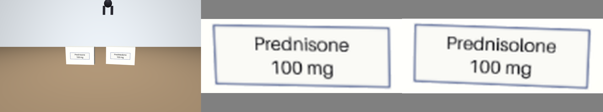

# Closed loop: can a robot policy reach the box named by its label?

Two identical cartons with look-alike labels sit on a table. A kinematic end-effector must move onto the one named in the instruction. The cartons differ only in their labels, so reading is the only cue.

## Results (20 November 2026)

SmolVLA fine-tuned from `lerobot/smolvla_base` on 600 scripted demonstrations per condition, 6,000 steps, one NVIDIA L4 per run. 200 test episodes per row; half use label pairs never seen in training.

| Policy is told | Print, camera | Correct | Wrong |
|---|---|---|---|
| Label text | 6 mm, 0.60 m | 54.5% [48–61] | 90 |
| Label text | 6 mm, 0.25 m | 50% [43–57] | 100 |
| Label text, backbone also trained | 6 mm, 0.60 m | 47% [40–54] | 106 |
| Green outline on the true target | 6 mm, 0.60 m | 100% [98–100] | 0 |
| Green outline on the true target | 2 mm, 0.60 m | 100% [98–100] | 0 |
| Outline placed by a reader, first view only | 2 mm, 0.60 m | 63.5% [57–70] | 73 |
| Outline placed by a reader that moves closer until confident, certified for 10% error | 2 mm, from 0.60 m | 96% [92–98] | 8 |
| The same, certified for 5% error | 2 mm, from 0.60 m | 96.5% [93–98] | 5, plus 2 declined |

- **Told the text, the policy guesses.** It goes left and right about equally often, on seen and held-out pairs alike. Moving the camera to 0.25 m and training the vision-language backbone do not help.
- **Told by a pointer, it never misses.** Same architecture, same amount of data and training. The motor part is easy; the reading is not.
- **A small reader fills the gap.** Qwen3.5-2B reads the labels from the full-resolution camera frame and marks its choice for the policy. With 6 mm print it was right in all 200 test episodes from the first view. With 2 mm print it is wrong 40% of the time from the first view, so it moves the camera closer until its confidence clears a threshold calibrated on 400 separate episodes.
- **The certified rates held on test:** 2.5% wrong among executed picks against a 5% target, and 4.0% against 10%.

Brackets are 95% Wilson intervals. Everything is in `results/`: per-episode outcomes in `results/eval`, the reader's transcriptions in `results/reads_*.json`, the threshold search in `results/decisions_*/report.json`, and training logs in `results/logs`.

## Cannot see, or does not learn?

The runs above cannot tell whether the policy fails because the text is too small in its input or because it does not learn to use it. So we gave it, besides the usual camera view, a close-up of each label as two extra camera inputs, with the text about 33 pixels tall instead of 4. Everything else is unchanged: 6 mm print, camera at 0.60 m, 6,000 steps, 200 test episodes.



| Names on the two cartons | Close-ups | Demonstrations | Correct | Seen pairs | Held-out pairs |
|---|---|---|---|---|---|
| Look-alike | no | 600 | 54.5% [48–61] | 56% | 53% |
| Look-alike | yes | 600 | 60% [53–67] | 66% | 54% |
| Look-alike | yes | 1,500 | 52.5% [46–59] | 53% | 52% |
| Look-alike, backbone also trained | yes | 600 | 52.5% [46–59] | 52% | 53% |
| Clearly different | no | 600 | 60.5% [54–67] | 67% | 54% |
| Clearly different | yes | 600 | **84% [78–88]** | **97%** | **71%** |

- **Seeing the text is necessary.** With clearly different names (for example Tramadol and Daunorubicin), the close-ups take the policy from 60.5% to 84%, and to 97% on names it trained on.
- **It is not sufficient.** With look-alike names (for example Prednisone and Prednisolone) the same, perfectly legible close-ups leave the policy at chance on pairs it has not seen. 2.5 times the demonstrations does not help, and neither does training the vision-language backbone.
- **So the policy learns to use text, but not to read closely.** Imitation from up to 1,500 demonstrations does not teach it the one- or two-letter differences that matter. That is the case for a separate reader.

The backbone-trained run used batch 12 (batch 16 runs out of memory with three cameras on a 24 GB L4), so it saw 72K samples instead of 192K. At a matched 64K samples the frozen-backbone run is also at chance (49.5%, `results/eval/text_crops_step2000.json`). Clearly different names pair the first line of two unrelated look-alike pairs, so their test set is separate (`results/inputs/test_specs_far_distinct.json`). The run script is `run_see_vs_learn.sh`.

## What this does not show

- One policy, at most 1,500 demonstrations per condition, 6,000 training steps.
- A kinematic end-effector with no contact or grasping.
- Label locations are given to the reader, and to the policy's close-ups.
- Whether an auxiliary objective (for example, asking the policy to transcribe the target label) or ten times the data would teach a policy look-alikes.
- Simulation only.

## Run it

Needs one or more NVIDIA GPUs with 24 GB, Python 3.10, PyTorch 2.9 and MuJoCo with EGL. Expect about two hours per training run on an L4.

```bash
sudo apt-get install -y python3-dev build-essential libegl1 ffmpeg
```

```bash
pip install "lerobot[smolvla]==0.4.4" mujoco rapidfuzz
```

The reader needs a newer `transformers` than LeRobot allows, so install it into its own folder:

```bash
pip install --target ~/reader_libs "transformers>=5.0.0" num2words "jinja2>=3.1"
```

Then, from this folder:

```bash
python make_dataset.py --test-specs data
```

```bash
bash run_all.sh 6000
```

```bash
PYTHONPATH=~/reader_libs python reader_decide.py read --specs data/test_specs_far_small.json --out results/reads_test_small.json
```

```bash
PYTHONPATH=~/reader_libs python reader_decide.py read --specs data/calibration2_specs_far_small.json --out results/reads_cal2_small.json
```

```bash
python reader_decide.py decide --calibration results/reads_cal2_small.json --test results/reads_test_small.json --out results/decisions_small
```

```bash
bash run_eval.sh
```

`run_all.sh` generates the demonstrations, applies `patch_lerobot_image_query.py` (a speed fix for LeRobot 0.4.4 when frames are stored as images; it returns the same values) and trains the four policies on four GPUs. `run_eval.sh` expects the reader's decision files in `results/decisions_small` and `results/decisions_small_a10` (the second from `decide --alpha 0.10`).

The see-or-learn runs are separate and also need four GPUs, about five hours on L4s:

```bash
bash run_see_vs_learn.sh 6000
```

## Files

| File | Purpose |
|---|---|
| `reach_env.py` | The MuJoCo scene, the scripted expert, and what the policy and the reader each see |
| `make_dataset.py` | Demonstrations as LeRobot datasets, plus fixed test and calibration episodes |
| `run_all.sh` | Data generation and the four training runs |
| `reader_decide.py` | The reader's looks at each distance, and the calibrated stop-when-confident rule |
| `eval_policy.py` | Closed-loop evaluation of a trained policy |
| `run_eval.sh` | All evaluations in the first table |
| `run_see_vs_learn.sh` | The see-or-learn runs: label close-ups, distinct names, more data, trained backbone |
| `patch_lerobot_image_query.py` | Data-loading speed fix for LeRobot 0.4.4 |
